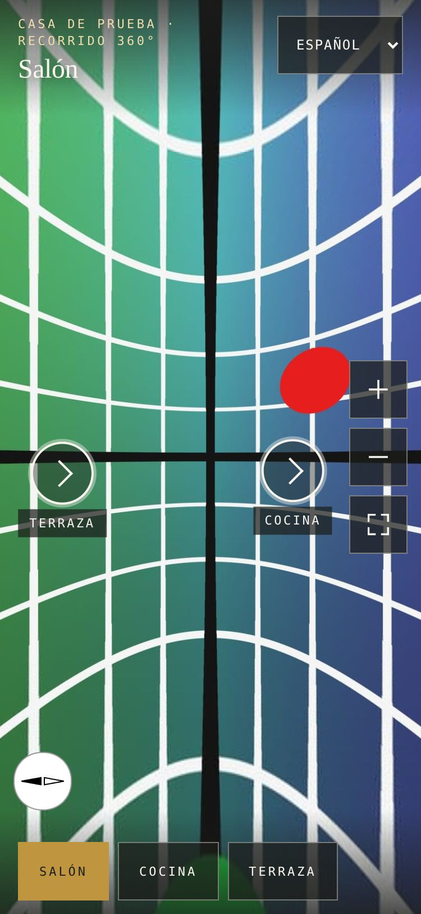
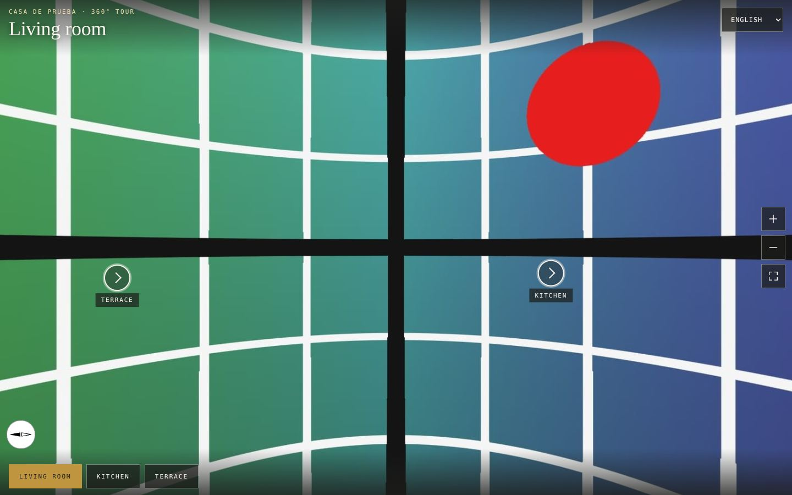

# Recorridos 360 (TOUR-360)

Visor de recorridos 360 de las casas, con fotos de la Insta360 X4 y [Pannellum](https://pannellum.org)
(MIT, alojado en este repo). Un solo visor para tres sitios: la ficha de la casa en la web, la
guest-app y la descripción de la casa en Beds24.

> **Estado (3-nov-2026): no hay ninguna foto real, así que no hay ningún recorrido publicado.**
> `/tour/<lo-que-sea>` da 404. El código, el script y la plantilla están listos; cuando lleguen las
> fotos, se procesan y se publica. Nada de este PR usa imágenes de ejemplo ni inventadas: las capturas
> y los tests usan una **cuadrícula sintética** generada por fórmula.

| Qué | Dónde |
|---|---|
| Ruta del visor (estática, incrustable) | `app/tour/[slug]/` → `/tour/<slug>` |
| Manifiesto por casa | `tours/<slug>/tour.json` (plantilla: `tours/_plantilla/`) |
| Esquema, idiomas, config de Pannellum | `lib/tour360/` |
| Botón «Ver en 360°» de la ficha | `components/tour360/tour360-lanzador.tsx` |
| Pannellum 2.5.7 (sin modificar) | `public/vendor/pannellum/` (procedencia y huellas en `ORIGEN.txt`) |
| Generador de tiles | `scripts/tour360-preparar/` · `npm run tour360:preparar` |
| Guía de rodaje (para Ángel) | [`TOUR-360-GUIA-RODAJE.md`](./TOUR-360-GUIA-RODAJE.md) |




*(La «casa» de las capturas es un fixture temporal con la cuadrícula sintética; no se versiona.)*

---

## 1. Cómo se ve y qué hace el visor

- **Escenas por estancia** (salón, cocina, dormitorios, terraza, piscina, pasillos…) con **hotspots**
  que llevan de una a otra, una **escena inicial** y una barra de estancias abajo.
- **Autoload**: al abrir `/tour/<slug>` el visor carga solo (Pannellum `autoLoad`), con indicador de carga.
- **Controles grandes en móvil**: 52 px en pantallas táctiles (`pointer: coarse`), 44 px con ratón. Zoom
  +/−, **pantalla completa**, y **giroscopio opcional** (botón solo si el dispositivo lo ofrece; en iOS pide
  permiso al pulsarlo; exige HTTPS). Teclado: flechas, +/−; los hotspots son botones enfocables (Enter).
- **Cinco idiomas: es, en, de, fr, it** (títulos de estancia, etiquetas, controles y errores). Selector
  de idioma dentro del visor. Resolución: `?lang=` → idioma del navegador → español. Cambiar de idioma
  conserva la estancia y la vista.
- Sin fundido entre estancias (corte directo): ver §9.

### Parámetros de URL

| Parámetro | Efecto |
|---|---|
| `?lang=es\|en\|de\|fr\|it` | Idioma. Un valor desconocido se ignora (se mira el navegador). |
| `?escena=<id>` | Abre en esa estancia (enlace directo a «la cocina»). Un id desconocido abre la inicial. |
| `?debug=1` | Panel con `pitch`/`yaw` del punto en que se pulsa: para **colocar hotspots** (ver §3). |

La ruta `/tour/` vive **fuera de `app/[locale]`** y `proxy.ts` la deja pasar sin next-intl: lleva sus cinco
idiomas (la web solo tiene cuatro; `it` no existe en `messages/`) y no debe heredar navegación ni pie de la
web dentro de un iframe. Es `noindex`: lo indexable es la ficha de la casa, que enlaza al visor.

---

## 2. Cómo se añade una casa (paso a paso)

1. **Rodaje** → [`TOUR-360-GUIA-RODAJE.md`](./TOUR-360-GUIA-RODAJE.md). Las fotos originales van a
   `tours-entrada/<slug>/<escena>.jpg` (carpeta **ignorada por git**).
2. **Manifiesto**: `cp -r tours/_plantilla tours/<slug>` y editar `tour.json`: `slug` (igual que la carpeta),
   `nombre`, `tiles.base` (§5), las estancias reales, sus títulos en los 5 idiomas y los enlaces.
3. **Tiles**: `npm run tour360:preparar -- --slug <slug> --entrada tours-entrada/<slug>`. Genera
   `tours-salida/<slug>/<escena>/…` y escribe el `multires` de cada escena en `tour.json`.
4. **Revisión de privacidad**: checklist de §7, escena por escena. **No se sube ni se publica sin ella.**
5. **Subir los tiles** a donde diga `tiles.base` (§5). El script no sube nada.
6. **Hotspots y norte**: abrir `/tour/<slug>?debug=1` en local, pulsar donde va cada enlace y copiar
   `pitch`/`yaw` al manifiesto (§3).
7. `"publicado": true` en `tour.json`. El esquema rechaza `publicado: true` si alguna escena no tiene
   `multires` o si alguna estancia no se alcanza desde la inicial por ningún hotspot.
8. PR. `npm run build` falla con un manifiesto inválido (mejor eso que un recorrido roto en producción).
9. Con el despliegue: la ficha de la casa enseña «Ver en 360°» (si la ficha existe: flag
   `SEDA_FLAG_ESCAPARATE_VILLAS`, VFT y arrendador, ver `lib/escaparate.ts`).

---

## 3. El manifiesto `tour.json`

```jsonc
{
  "version": 1,
  "slug": "bay-side",                  // = nombre de la carpeta
  "nombre": "Bay Side",                // tal cual, no se traduce
  "publicado": false,                  // true solo tras la checklist de privacidad
  "escenaInicial": "salon",
  "norte": 90,                         // OPCIONAL: grados horarios N → centro de la imagen
  "tiles": { "base": "/tours/bay-side/v1" },
  "escenas": [
    {
      "id": "salon",                   // = nombre del fichero: salon.jpg
      "titulos": { "es": "Salón", "en": "Living room", "de": "Wohnzimmer", "fr": "Salon", "it": "Soggiorno" },
      "multires": { "tileResolution": 512, "maxLevel": 4, "cubeResolution": 3784, "extension": "jpg" }, // lo escribe el script
      "norte": 100,                    // OPCIONAL: sobrescribe el del recorrido
      "vistaInicial": { "yaw": 0, "pitch": 0, "hfov": 100 },   // OPCIONAL
      "hotspots": [
        { "escena": "cocina", "pitch": -4, "yaw": 25 }          // pitch/yaw DENTRO de esta escena
      ]
    }
  ]
}
```

- **Coordenadas**: `yaw` −180…180 (0 = centro de la imagen, positivo hacia la derecha), `pitch` −90…90
  (positivo hacia arriba). Con `?debug=1`, al pulsar se muestra `{ "escena": "<destino>", "pitch": …, "yaw": … }`.
  Contrastado a mano: en un visor de 1000×700 con hfov 100°, pulsar en (620, 300) da yaw 16,0° y pitch 6,5°,
  que es lo que sale de `atan(0,24/0,839)` y `atan(0,1/0,873)`.
- **Etiqueta del hotspot**: por defecto, el título de la estancia de destino en el idioma activo; `titulos`
  en el hotspot la sobrescribe. `destinoYaw`/`destinoPitch` fijan hacia dónde mira el visitante al llegar.
- **Norte**: `norte` = grados horarios desde el norte hasta el **centro de la imagen** (Pannellum:
  `northOffset`). Solo se pone si se ha **medido** (brújula en el punto de la toma, apuntando la lente
  frontal). **Sin norte no hay brújula**: no se muestra un norte inventado.
- **Escena inicial**: `escenaInicial` (y `vistaInicial` de cada escena).
- El esquema vive en `lib/tour360/manifiesto.ts` (zod) y se prueba en `tests/tour360-manifiesto.test.ts`.

---

## 4. Rendimiento

### Las fotos y el script

La X4 en modo 72 MP saca equirectangulares de **11904×5952** (≈71 MP; dato publicado por Insta360, a
confirmar con la primera foto real). Cargar eso en el navegador no es viable (≈ 280 MB de textura), de ahí el
**multires** de Pannellum: la imagen se parte en 6 caras de cubo y cada cara en tiles de 512 px a varios
niveles; el visor solo pide los tiles de lo que se ve, a la resolución que toca.

`scripts/tour360-preparar` es el **equivalente** de `generate.py` de Pannellum. No se usa `generate.py` tal
cual porque necesita Python + Pillow + `nona` (Hugin), y no hay garantía de tenerlos donde se procesan las
fotos. El script usa `sharp` (ya instalado por Next) y escribe **el mismo formato** (caras `f b u d l r`,
rutas `/%l/%s%y_%x` y `/fallback/%s`, mismo cálculo de niveles). Por cada escena:

| Salida | Qué es |
|---|---|
| `<nivel>/<cara><fila>_<col>.jpg` | tiles multirresolución, 512 px, JPEG calidad 80 (mozjpeg) |
| `fallback/<cara>.jpg` | base de baja resolución (512 px por cara) |
| `preview.jpg` | **preview de baja resolución**: equirectangular 1024×512, marcador mientras carga |
| `multires.json` | parámetros (y se copian a `tour.json`) |

Los JPEG salen **sin metadatos** (ni EXIF/GPS ni XMP de la toma): probado con una marca metida a propósito en
el EXIF de la entrada.

```bash
npm run tour360:preparar -- --slug bay-side --entrada tours-entrada/bay-side
npm run tour360:preparar -- --help
```

Valida **antes de empezar** (nombres de fichero, escenas que no están en el manifiesto) para no perder
minutos de proceso por un nombre mal escrito. Rechaza lo que no sea 2:1.

**Medido (3-nov-2026, este entorno)** con una equirectangular sintética de 11904×5952 (70,9 MP):

| | |
|---|---|
| Tiempo por escena | **19 s** |
| Ficheros por escena | **517** = 510 tiles (6 caras × (64+16+4+1)) + 6 fallback + 1 preview |
| Cálculo a mano | cubo 3784 → niveles 473 / 946 / 1892 / 3784 → 1 / 4 / 16 / 64 tiles por cara → 85 × 6 = 510 ✔ |
| Memoria | ≈ 680 MB (RSS) |

El **peso** depende de cuánto detalle tenga la foto, y una cuadrícula sintética comprime muchísimo mejor que
una casa: aquella escena pesó 5,2 MB, que es una **cota inferior**. Para dimensionar se usa una
**estimación de 15–30 MB por escena** (no medida: 510 tiles de 512×512 a unos 30–60 KB cada uno). **La
primera escena real da el dato**: el script imprime el total y lo guarda en `tours-salida/<slug>/informe.json`.
Hasta entonces, trátese como estimación.

### Carga diferida (el LCP de la ficha)

«Ver en 360°» es un **enlace** (`<a href="/tour/<slug>?lang=…">`). Hasta que se pulsa, la ficha **no pide
nada del visor**: ni iframe, ni Pannellum, ni tiles, ni imagen de portada del tour. Al pulsar (con JS) se monta
un `<dialog>` a pantalla completa con un `<iframe>`; al cerrarlo el iframe se desmonta y libera WebGL. Sin JS,
o con Ctrl/⌘/clic central, abre el visor en otra pestaña.

**Medido** (Chromium, móvil emulado 375×812, CPU ×4, red 1,6 Mbps / 150 ms, 7 pasadas por variante, mismo
build salvo que la casa tenga o no un recorrido publicado; ficha de Bay Side con datos de prueba
temporales):

| | LCP (ms), mediana | Rango |
|---|---|---|
| Sin recorrido | 1664 | 1644–1676 |
| **Con recorrido** («Ver en 360°» en la ficha) | **1648** | 1628–1676 |

El elemento LCP es la misma imagen de portada en ambos. Antes de pulsar, **cero** peticiones a `/tour`,
`/tours` o `pannellum`. Con recorrido: mismos 53 recursos, mismos 854 885 bytes de JS (el lanzador se
empaqueta en la ficha con o sin recorrido; su tamaño propio no se ha aislado) y **+782 B de HTML**. Tras pulsar: el iframe carga,
el visor renderiza y **Esc** lo cierra y desmonta el iframe.

*Esta medición es local y emulada, no Lighthouse en producción; sirve para decir «no empeora», no para
fijar un número absoluto.*

---

## 5. Alojamiento de los tiles (decisión pendiente de Ángel)

**No se ha subido nada.** Cuentas con la estimación de §4 (≈ 25 MB por escena, ≈ 10 escenas por casa):

| Opción | Caben | Veredicto |
|---|---|---|
| **`public/` del repo** | ≈ 250 MB por casa | **No.** Infla el repo (cada clon) y cada despliegue de Vercel; la CI ya vigila el peso de `public/` (`tests/public-assets.test.ts`) y `tests/tour360-privacidad.test.ts` limita `public/tours/` a 20 MB. Sirve solo para una escena de prueba. |
| **Supabase Storage** (bucket público) | **Recomendada** | Ya está en el stack de SEDA; un bucket público de solo lectura; cabeceras de caché configurables al subir. |
| **Vercel Blob** | Válida | Mismo panel que el alojamiento; un token más y un script de subida. |

### Recomendación: Supabase Storage, bucket público `tours-360`

**Coste** (fuentes oficiales; **comprobar en la página de precios antes de contar con ello**):

- **Supabase** (plan Pro): 100 GB de almacenamiento incluidos (después 0,021 $/GB·mes) y 250 GB de
  transferencia (egress) compartida con todo el proyecto (después 0,09 $/GB).
  [Precios](https://supabase.com/docs/pricing) · [uso de egress](https://supabase.com/docs/guides/platform/manage-your-usage/egress).
  **No me consta qué plan tiene SEDA**; en el plan gratuito los límites son mucho menores.
- **Vercel Blob**: 0,023 $/GB·mes de almacenamiento y desde 0,05 $/GB de transferencia (según región); una
  fuente reciente apunta a que la transferencia podría ir incluida en el CDN de tarifa plana: **verificarlo**.
  [Precios](https://vercel.com/docs/vercel-blob/usage-and-pricing).

Con la estimación (no medida): 20 casas × 250 MB = **≈ 5 GB** de almacenamiento (Supabase: dentro de lo incluido;
Vercel Blob: ≈ 0,12 $/mes). Cada visita carga solo lo visible: fallback (6 imágenes de 512 px) más los tiles de
la vista, **≈ 2–6 MB por estancia visitada** (estimación); 1000 visitas al mes de 4 estancias ≈ 10–25 GB de
transferencia: dentro de lo incluido en Supabase Pro; en Vercel Blob ≈ 0,5–1,25 $. **Ninguna de las dos
opciones es cara a este volumen**; la elección es de encaje, no de coste. Se recomienda Supabase por estar ya
en el stack y por no añadir otro proveedor de facturación.

### Cómo dejarlo (cuando Ángel decida; Claude Code no escribe en Supabase)

1. **Ángel** crea el bucket público `tours-360` en Supabase Studio (crear bucket/políticas es cambio de
   esquema: lo hace él, no Claude Code; ver `CLAUDE.md`).
2. Sube `tours-salida/<slug>/` a `tours-360/<slug>/<versión>/`, con `Cache-Control: public, max-age=31536000`.
   **La versión va en la ruta** (`v1`, `v2`…): los tiles son inmutables; si se repite el rodaje, carpeta nueva y
   `tiles.base` nuevo (así no hay tiles viejos en caché).
3. **Comprobar** con `curl -I <url de un tile>`: debe responder 200 con `access-control-allow-origin`. El visor
   pide los tiles con `crossOrigin=anonymous` (WebGL lo exige); sin esa cabecera, el visor no pinta.
4. Un PR pequeño que:
   - ponga `tiles.base` = `https://<proyecto>.supabase.co/storage/v1/object/public/tours-360/<slug>/v1`;
   - añada **ese origen exacto** a `ORIGENES_TILES_EXTERNOS` (`lib/tour360/origenes.ts`);
   - lo añada a `img-src` y `connect-src` de la regla `/tour/(.*)` de `vercel.json`.
   `tests/tour360-cabeceras.test.ts` falla si `vercel.json` y `origenes.ts` no coinciden, y el esquema
   rechaza una `tiles.base` externa que no esté en la lista.

*Alternativa que no cambia la CSP*: una `rewrite` de Vercel de `/tours/*` al bucket (los tiles salen como
mismo origen). A cambio, el tráfico pasa por Vercel (se factura como transferencia de Vercel). No se ha
hecho; es una segunda opción si la CORS del bucket diera guerra.

---

## 6. Incrustación

El visor se puede enmarcar **solo** desde la propia web, la guest-app y beds24.com. Se hace con
`frame-ancestors` (CSP), en la regla `/tour/(.*)` de `vercel.json`:

```
frame-ancestors 'self' https://guests.sedaprivatehomes.com https://beds24.com https://www.beds24.com
```

| Origen | Fuente |
|---|---|
| `'self'` | la ficha de la web (usa el mismo visor) |
| `https://guests.sedaprivatehomes.com` | `components/navigation.tsx` (`GUEST_APP_URL`) |
| `https://beds24.com` | `lib/escaparate.ts` (`BEDS24_BOOKING_URL`) |
| `https://www.beds24.com` | **no consta** como origen de la booking page; se incluye por si Beds24 la sirve con «www». Si se comprueba que no hace falta, se quita (`lib/tour360/origenes.ts`). |

`/tour/` no envía `X-Frame-Options` (contradiría la lista) y **se excluye de la CSP global** con un lookahead
(`"/((?!tour/).*)"`), porque dos CSP sobre una misma respuesta se **intersecan** y `'none'` ∩ lista = nadie.
La ficha necesita además `frame-src 'self'` en la CSP global, para enmarcar el visor propio.

> **A comprobar en el preview de Vercel**: el patrón se ha probado con el `path-to-regexp` de Next
> (`tests/tour360-cabeceras.test.ts`), no con el de Vercel. Tras el despliegue:
> `curl -sI https://<preview>/tour/x | grep -i content-security` (debe llevar `frame-ancestors 'self' https://guests…`)
> y `curl -sI https://<preview>/coleccion | grep -i content-security` (debe seguir en `frame-ancestors 'none'`).

### Desde la guest-app

Enlace directo (siempre funciona, abre una pestaña):

```
https://sedaprivatehomes.com/tour/<slug>?lang=<idioma>[&escena=<id>]
```

Incrustado (idioma de la guest-app → `lang`, uno de `es en de fr it`; otro valor se ignora):

```html
<iframe
  src="https://sedaprivatehomes.com/tour/bay-side?lang=de"
  title="360°"
  allow="fullscreen; gyroscope; accelerometer"
  allowfullscreen
  loading="lazy"
  referrerpolicy="strict-origin-when-cross-origin"
  style="width:100%;height:70vh;border:0"></iframe>
```

- **`allow="fullscreen; gyroscope; accelerometer"` es necesario**: sin él, el iframe no puede ponerse a
  pantalla completa ni leer el giroscopio (el botón del giroscopio no aparece).
- `loading="lazy"` en el iframe, o montarlo al pulsar un botón (como la ficha), para no cargar el visor en
  cada pantalla de la guest-app. No añadir `sandbox` sin `allow-scripts allow-same-origin`.
- Un `?escena=<id>` permite enlazar desde una sección concreta («cocina», «terraza»).

### Desde la descripción de la casa en Beds24

**No se ha tocado Beds24** (fuera de alcance) y **no me consta qué HTML admite la descripción**: muchos
gestores filtran `<iframe>`. Orden recomendado: (1) un **enlace** `https://sedaprivatehomes.com/tour/<slug>?lang=<idioma>`
en la descripción (funciona seguro); (2) si la descripción admite `<iframe>`, el fragmento de arriba. Si el
iframe aparece vacío, la consola del navegador dirá «Refused to frame … frame-ancestors»: se anota el origen
que muestre y se añade a `origenes.ts` y `vercel.json` (con su fuente).

---

## 7. Privacidad

### Garantía técnica (se comprueba en tests, no se promete)

El visor **no lleva analítica ni cookies**: sin `document.cookie`, `localStorage`/`sessionStorage`/IndexedDB,
sin librerías de medición, sin `fetch`/WebSocket propios, sin URLs absolutas en el código del visor, sin
`next/font` ni scripts de terceros. Pannellum se sirve desde `public/vendor/pannellum` (huellas sha256 en
`ORIGEN.txt`; no usa cookies, almacenamiento ni beacons, y solo nombra dos URLs, en sus créditos). El idioma
**no se guarda** (viene de la URL o del navegador). La CSP del visor es `default-src 'self'`: el navegador
rechazaría cualquier tercero. Lo hace cumplir `tests/tour360-privacidad.test.ts` y se midió en Chromium con la
CSP real: las únicas peticiones salen al propio origen y no hay violaciones.

Los tiles salen **sin EXIF/GPS/XMP** (§4). Ojo: eso no limpia lo que **se ve** en la foto.

### Checklist de revisión ANTES de publicar

Una persona, escena por escena, **con el zoom al máximo** (los tiles de alta resolución enseñan lo que a
simple vista no se ve; un papel sobre la mesa se lee a 3784 px) y mirando las 6 direcciones, **incluidos
cénit y nadir**. Marcar cada punto; un solo «sí» a un riesgo = **repetir la toma** (retocar solo si no hay otra).

- [ ] **Documentos**: pasaportes/DNI, contratos, facturas, cartas, recetas, tarjetas de visita, notas
      adhesivas con datos, el libro/cuaderno de bienvenida abierto con nombres o teléfonos, calendarios y pizarras.
- [ ] **Pantallas encendidas**: móvil, tablet, portátil, TV (¿qué muestra?), navegador, notificaciones.
- [ ] **Caras**: personas en la casa, en el exterior, **en los balcones o ventanas de los vecinos**, en
      fotos y cuadros enmarcados de la familia propietaria; **reflejos** en espejos, cristales, el horno y la
      puerta del microondas (el fotógrafo y el trípode no deben salir).
- [ ] **Matrículas**: coches visibles desde ventanas, terrazas, la calle o el garaje; se leen más de lo que parece.
- [ ] **Datos de acceso**: teclado de la cerradura con código a la vista, **código de caja de llaves/Nuki**,
      llaves colgadas, contraseña del wifi en una pegatina o en el router, claves de alarma o de caja fuerte.
- [ ] **Dirección exacta**: número y nombre de la calle en una placa, buzón o factura; carteles de comunidad.
- [ ] **Objetos personales del propietario**: ropa, medicación, juguetes, fotos, objetos de valor a la vista,
      armarios abiertos.
- [ ] **Gente tomando el sol o en la piscina** (propia o de la comunidad) en las escenas de exterior.
- [ ] **Metadatos de la entrada**: la ubicación de la cámara/app estaba **desactivada** al disparar (aun así
      el script los elimina; comprobarlo con `exiftool` en un tile si se quiere).
- [ ] **Colores**: un tile comparado con el JPG original (si la X4 exporta con perfil distinto de sRGB, el script
      lo convierte a sRGB y borra el perfil).

**Registro**: en la descripción del PR que pone `"publicado": true`, una línea por casa con **fecha, nombre de
quien revisó y «checklist completa, N escenas»**. Quien publica no es quien revisó, si se puede.

---

## 8. Verificación

### El tiler, contra Pannellum (no contra sí mismo)

Un test escrito por quien escribió el código solo demuestra consistencia interna. Que las caras salgan con la
orientación que Pannellum espera **solo se prueba renderizando en Pannellum**. `scripts/tour360-preparar/verificar-con-pannellum.mjs`
renderiza la misma cuadrícula sintética como equirectangular directa y como multires del tiler, en 14 vistas
(horizontales, oblicuas, cénit y nadir), y compara:

```
node scripts/tour360-preparar/verificar-con-pannellum.mjs      # requiere: npm i --no-save playwright
```

Resultado (3-nov-2026): **14/14 por debajo de 5/255** (mediana 0,85; máxima 2,71 en pitch 60, tiles aún
cargando). **Controles negativos** (cara `u` girada 180°; cara `l` espejada): subieron a **63/255** y **27/255**:
la comprobación detecta el fallo que dice detectar. Se vuelve a ejecutar al tocar `tiler.mjs` o al actualizar
Pannellum o `sharp`; no corre en CI (necesita un navegador).

### Tests (`npm test`)

| Fichero | Qué protege |
|---|---|
| `tests/tour360-tiler.test.ts` | niveles y tiles de una X4 (aritmética a mano), posición de marcadores en cada cara (trigonometría a mano), estructura en disco, borrado de EXIF/XMP |
| `tests/tour360-manifiesto.test.ts` | esquema, plantilla, 5 idiomas completos, config de Pannellum, carga en build, «hoy no hay nada publicado» |
| `tests/tour360-cabeceras.test.ts` | CSP de `/tour/*`, `frame-ancestors` exacto, las dos CSP no se solapan, `proxy.ts` deja pasar `/tour/` |
| `tests/tour360-privacidad.test.ts` | huellas de Pannellum, sin analítica/cookies/terceros, `.gitignore`, sin fotos originales ni tiles en el repo |
| `tests/tour360-preparar-cli.test.ts` | el script de extremo a extremo |

---

## 9. Decisiones y límites conocidos

- **Sin fundido entre estancias.** El fundido de Pannellum pinta el canvas en una imagen `data:`; la CSP del visor
  no abre `img-src data:` (medido: con fundido, la estancia de destino se queda colgada). Corte directo.
- **`sharp` no se declara en `package.json`**: llega con Next como dependencia opcional (`npm ci` la instala). Añadirla
  como `devDependency` desde el npm de este entorno (10.x) reescribía el `package-lock.json` y perdía los campos
  `libc` de los binarios `@img/*`, así que se dejó fuera. Si Cowork usa npm 11, `npm i -D sharp` es seguro.
- **La ruta `/tour/` hereda 3 `preload` de fuentes y 1 de CSS** del `not-found` raíz (`app/not-found.tsx` importa
  `next/font` y `globals.css`). No se usan en el visor y solo cuestan en el iframe; arreglarlo exige reestructurar
  los layouts raíz (grupos de rutas), fuera de alcance.
- **«72 MP con HDR» no se combinan en la X4** (ver la guía de rodaje).
- El patrón de cabeceras se ha probado con `path-to-regexp` de Next; hay que comprobarlo una vez en el preview de Vercel (§6).
- Textos nuevos (títulos de estancia de la plantilla, interfaz del visor en 5 idiomas, `tour360.*` en
  `messages/`) — **pendientes de revisión de Ángel**.
